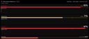

# Claude Code Monitor — iCUE widget for the CORSAIR XENEON EDGE

An iCUE HTML widget that shows your Claude subscription usage the way the Claude Code VS Code
extension's *Account & Usage* panel does — session (5 h), weekly (7 day) and model-specific
limits with live reset countdowns — plus the Claude Code sessions running on this PC and your
Claude Code web sessions.



It has two parts:

| Part | What it does |
| --- | --- |
| `widget/` | The `.icuewidget` package that runs on the XENEON EDGE. It only talks to `http://127.0.0.1:41780`. |
| `server/` | A small **companion server** (Node.js, no dependencies) that reads Claude Code's local files, talks to Anthropic's API on your behalf and serves one JSON document to the widget. |

The iCUE webview cannot read files on disk or hold your OAuth token safely, which is why the
companion server exists. It never exposes the token: the JSON it serves contains percentages,
timestamps, your account e-mail/plan and session names only.

## What it shows

| Area | Content |
| --- | --- |
| Top bar | Account e-mail, plan (e.g. *Max 20x*), data freshness. Tap it to force a refresh. |
| Account & Usage | One meter per limit reported by Anthropic (today: *Session (5hr)*, *Weekly (7 day)*, *Fable limit*; new model-scoped limits appear automatically). Each row has the percentage, a bar coloured by severity (accent → amber at the warning threshold → red at the critical threshold, or when Anthropic flags it critical), a live **"Resets in 2h 14m"** countdown (tap a row to switch to the absolute time), a **pace chip** (*on pace* / *tight* / *hot* — where you would land at the current burn rate), the burn rate (%/h for the session window, %/day for weekly ones), *"100% in 1h 40m"* when you will hit the limit before it resets, a thin tick marking how much of the window has elapsed, and a 24 h **sparkline** of the history the server records. The limit Anthropic marks as active gets a coloured marker. Extra-usage credits appear as a row when enabled. |
| Local sessions | Every Claude Code process on this PC (VS Code and terminal), with the transcript's AI title (or the session name), project folder, entry point badge, status (*busy* / *waiting* / *idle*, the dot pulses when active), last activity and elapsed time. A *remote* badge marks sessions bridged to Remote Control. Tap the title to cycle the sort order (activity → started → name). Stale registry files left by crashed processes are filtered out by pid **and** process start time. |
| Web sessions | Your Claude Code on the web sessions (title, repository, branch, *running* / *waiting* / *idle*, last activity, a *needs you* badge when a session waits for input). This uses an internal API and degrades to *"Web sessions unavailable"* if it changes. |
| Banners | Companion offline (last data kept on screen, dimmed), token expired, no credentials, usage API rate limited (with retry countdown), stale usage data, access-token mismatch. |

### Supported slots

| Slot | Size | Layout |
| --- | --- | --- |
| Extra Large horizontal | 2536×696 | Usage · Local sessions · Web sessions |
| Large horizontal | 1688×696 | Usage · Local sessions (web sessions collapse into a top-bar chip) |
| Medium horizontal | 840×696 | Usage only, session counts as chips |
| Small horizontal | 840×344 | Three compact one-line meters |
| Vertical | 696×… | Stacked; not tuned on a device |

## Install

Requirements: Windows, iCUE 5.47 or newer with a XENEON EDGE, Node.js 20.9+ and a Claude Code
login on this PC (the widget reads the same credentials Claude Code uses).

1. Clone this repo and run `npm install`.
2. Start the companion server: `npm run serve` (or install it as a hidden logon task with
   `npm run autostart:install`; `npm run autostart:uninstall` removes it again).
   Check it with `curl http://127.0.0.1:41780/healthz`.
3. Build the widget: `npm run build` → `dist/claude-monitor.icuewidget`.
4. Double-click the `.icuewidget` file, or open iCUE → XENEON EDGE → Widgets → **+** and pick the file.
5. Drop **Claude Code Monitor** into an Extra Large (or Large) horizontal slot.

If the widget shows *"Companion server not reachable"*, the server is not running or the port in
the widget settings does not match `config.json`.

A first install must go through the `.icuewidget` import. iCUE's file watcher also lists a widget that
was only copied into its `html_widgets` folder (`npm run sync`), but such a widget has no permission
record and renders a black slot; `npm run sync` is only for updating a widget that was imported once.

## Settings (iCUE widget panel)

| Group | Setting | Default | Notes |
| --- | --- | --- | --- |
| Companion server | Server port | 41780 | must match `port` in `config.json` |
| Companion server | Server access token | `none` | paste the `token` from `config.json` if you set one; `none` means no token |
| Companion server | Refresh interval | 10 s | how often the widget asks the server (the server polls Anthropic far less often) |
| Usage | Warning / Critical threshold | 60 % / 85 % | bar colours |
| Usage | Sparklines | on | 24 h history under each meter (XL/L only, and only with ≤ 3 limits) |
| Usage | Reset display | Countdown | Countdown or absolute time; a tap on any row toggles it |
| Sessions | Show web sessions | on | |
| Sessions | Show idle sessions | on | idle sessions are still counted when hidden |
| Sessions | Session sort | Activity | initial sort; tap the title to cycle |
| Display | Clock format | 24 h | |
| Display | Density | Comfortable | Compact tightens rows and hides burn rates |
| Widget Personalization | Text / Accent / Background colour, Transparency | white / Claude orange / black / 100 % | |

## Companion server

```
npm run serve            # foreground, logs to the console and %LOCALAPPDATA%\icue-claude-monitor\server.log
npm run once             # poll everything once and print the JSON the widget would receive
node server/index.mjs --help
```

Config lives in `%LOCALAPPDATA%\icue-claude-monitor\config.json` (created with defaults on first run):

| Key | Default | Meaning |
| --- | --- | --- |
| `port` | 41780 | loopback port |
| `token` | "" | if set, requests must carry it (`?token=` or `X-Widget-Token`); paste it into the widget's *Server access token* |
| `usageCacheMaxAgeSeconds` | 300 | use Claude Code's own cached usage response when it is younger than this |
| `usageIntervalSeconds` | 180 | minimum spacing of network polls to the usage endpoint (never below 120) |
| `cloudIntervalSeconds` | 60 | web sessions poll |
| `localPollSeconds` | 5 | local sessions poll (a file watcher reacts faster) |
| `historyHours` / `historyStepSeconds` | 24 / 180 | sparkline history kept in `history.json` |
| `cloudEnabled` | true | set to false (or run with `--no-cloud`) to skip web sessions |
| `sessionTitles` | true | read the AI title from each session's transcript |
| `claudeConfigDir` / `claudeJsonPath` | null | override `~/.claude` (also honours `CLAUDE_CONFIG_DIR`) and `~/.claude.json` |
| `userAgent` | null | override the User-Agent sent to Anthropic |

Endpoints (all JSON, CORS `*`): `GET /healthz`, `GET /api/state[?history=0]`, `POST /api/refresh`.

### Data sources and privacy

Everything is read locally except two HTTPS calls to `api.anthropic.com`, both made with the
OAuth token Claude Code already stores on this PC:

- **Usage**: Claude Code caches the last usage response in `~/.claude.json`; the server reads it
  from there (no network at all while Claude Code is open and refreshing it) and only calls the
  usage endpoint itself when that cache is older than `usageCacheMaxAgeSeconds`. Network polls
  are spaced at least `usageIntervalSeconds` apart with exponential backoff and honour
  `retry-after`, because the endpoint rate-limits aggressive pollers.
- **Web sessions**: the sessions endpoint the VS Code extension uses. Undocumented; best effort.
- **Account**: the `oauthAccount` block in `~/.claude.json`.
- **Local sessions**: `~/.claude/sessions/<pid>.json`, checked against the live process list
  (pid *and* process start time) so files left behind by crashed processes are ignored.
- **Token**: read from `~/.claude/.credentials.json` and kept in memory only. The server never
  refreshes it — Claude Code owns that file — so if it expires the widget says so and keeps
  showing the last data until you use Claude Code again.

The `/api/state` document contains your e-mail, project names and session titles. It is served on
loopback only, but any page on this PC could read it; set `token` in `config.json` if that matters
to you. The server log redacts anything that looks like a credential.

## Development

```
npm run serve:mock -- --port 41781     # canned scenarios: normal, critical, tokenExpired, rateLimited, noCloud, empty, manyLimits
npm run dev                            # static server -> http://localhost:8080/tools/preview.html?serverPort=41781
npm test                               # unit tests (limits normalisation, formatting, pace math, FILETIME, session merge, HTTP, mock)
node tools/screenshot.mjs --scenario critical          # headless Chrome/Edge screenshots at every slot size -> tools/.shots
node tools/screenshot.mjs --offline --sizes 2536x696   # companion-offline state
node tools/screenshot.mjs --set density=compact,clockFormat=12 --mock-tr
node tools/make-preview.mjs                            # regenerates widget/resources/preview.png (128x56)
npm run validate / npm run package / npm run build
npm run sync                           # copy widget/ into %APPDATA%\Corsair\CUE5\html_widgets\com\calderon\claudemonitor (restart iCUE)
curl -X POST "http://127.0.0.1:41781/api/mock/scenario?name=rateLimited"   # switch the mock scenario live
```

Browser-only query parameters for the harness: any setting key (`?density=compact&clockFormat=12`),
plus `nowait=1` (skip the iCUE boot wait) and `serverPort=41781`.

### Troubleshooting on the device

`npm run probe` builds `dist/claude-probe.icuewidget`, a one-page diagnostic widget. Import it and drop
it into any slot: it prints whether the page loaded, the origin iCUE serves widgets from, the user agent,
whether iCUE initialised the page, and the result of `fetch` and `XMLHttpRequest` to
`http://127.0.0.1:<port>/healthz`. A black slot with the probe too means iCUE is not loading the widget
files at all (re-import the `.icuewidget` file instead of only syncing the folder); a failed fetch means
the webview blocks loopback HTTP and the server-side `state.json` fallback would be needed.

## Project layout

```
widget/            the packagable widget (only this folder goes into the .icuewidget)
  index.html       CSP, iCUE meta properties and groups, DOM skeleton
  manifest.json    translation.json (en + es)
  styles/widget.css
  scripts/         icue-bridge (iCUE runtime), format (pure helpers), data (server client), sparkline, ui, main
  resources/       icon.svg, preview.png (generated)
server/            companion server: config, log, poller, claude-files, usage, limits, history, procs, sessions-local, sessions-cloud, state, http, mock, index
tools/             dev server, preview harness, screenshot and preview generators, sync, autostart scripts, mock scenarios, tests
```

## License

MIT
